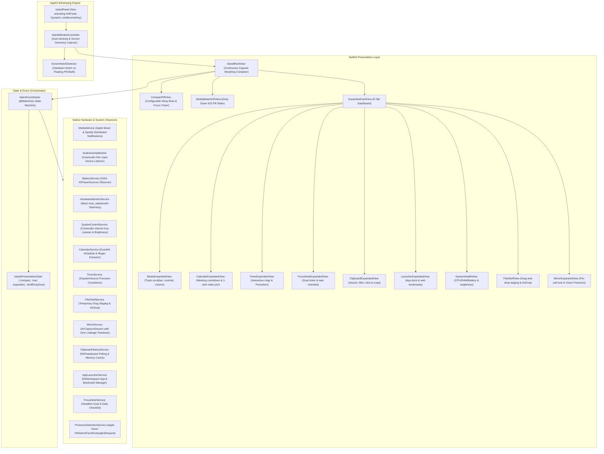

# OpenHalo Technical Architecture

OpenHalo is an open-source, zero-dependency native macOS status-item and Dynamic Island application built with **Swift 6**, **SwiftUI**, and **AppKit**.

---

## 1. High-Level System Architecture



---

## 2. Windowing Engine & Focus Invariants

### 2.1 Dynamic Non-Activating Floating Panel
To maintain macOS system responsiveness without stealing keyboard focus or disrupting active full-screen applications:
- **Subclass**: `NSPanel` with styles `[.borderless, .nonactivatingPanel]`.
- **Window Level**: `.statusBar` (`CGWindowLevelKey.statusWindow`), placing the island cleanly over full-screen apps and system menu bars.
- **Collection Behavior**: `[.canJoinAllSpaces, .fullScreenAuxiliary, .ignoresCycle]`.
- **Dynamic Keyboard Focus**: `canBecomeKey` is dynamically gated by `IslandCoordinator.shared.requiresKeyboardFocus`. During normal mouse moves, hover peeks, and tab navigation, focus is strictly rejected (`false`), ensuring Xcode, Terminal, or games are never interrupted. Focus is only temporarily acquired when clicking an active search or note input, and is immediately released on collapse.

### 2.2 Notch Geometry Detection
```swift
// Hardware Notch Detection
let screen = NSScreen.main ?? NSScreen.screens[0]
let safeArea = screen.safeAreaInsets
let hasPhysicalNotch = safeArea.top > 0

if hasPhysicalNotch {
    // Docked flush against MacBook Pro / Air notch bezel:
    // Uses screen.auxiliaryTopLeftArea and auxiliaryTopRightArea to establish exact width
} else {
    // Floating Pill Mode:
    // Centered horizontally with an 8pt margin from screen.frame.maxY
}
```

---

## 3. Privacy & Security Implementation

### 3.1 Zero-TCC Microphone Activity Monitor
Unlike tools that record audio to visualize microphone activity, `AudioActivityMonitor` queries the CoreAudio Hardware Abstraction Layer directly:
- Listens for `kAudioDevicePropertyDeviceIsRunningSomewhere` on the default input device (`kAudioHardwarePropertyDefaultInputDevice`).
- Captures **zero audio samples and reads zero buffers**.
- Requires **no microphone recording permissions** (`NSMicrophoneUsageDescription`), ensuring user privacy by design.

### 3.2 Single-Burst On-Device Vision Presence Check
`PresenceDetectionService` uses Apple's native `Vision` framework (`VNDetectFaceRectanglesRequest`) for privacy-preserving user presence checks:
- **100% On-Device**: Analyzed locally using the Apple Neural Engine. Zero frames are ever saved to disk or transmitted over the network.
- **Strict Power Cutoff**: Runs exclusively in single-burst mode (spins up camera, processes 1 frame, and immediately halts the `AVCaptureSession`), preventing the green hardware camera LED from latching on.

### 3.3 MediaMate-Style Native HUD Replacement
`SystemControlService` registers CoreAudio property listener blocks on `kAudioDevicePropertyVolumeScalar`. Whenever volume keys (F11/F12) are adjusted, OpenHalo drops a fluid, iOS-style pill slider banner from the notch that automatically dismisses after 1.8 seconds.
