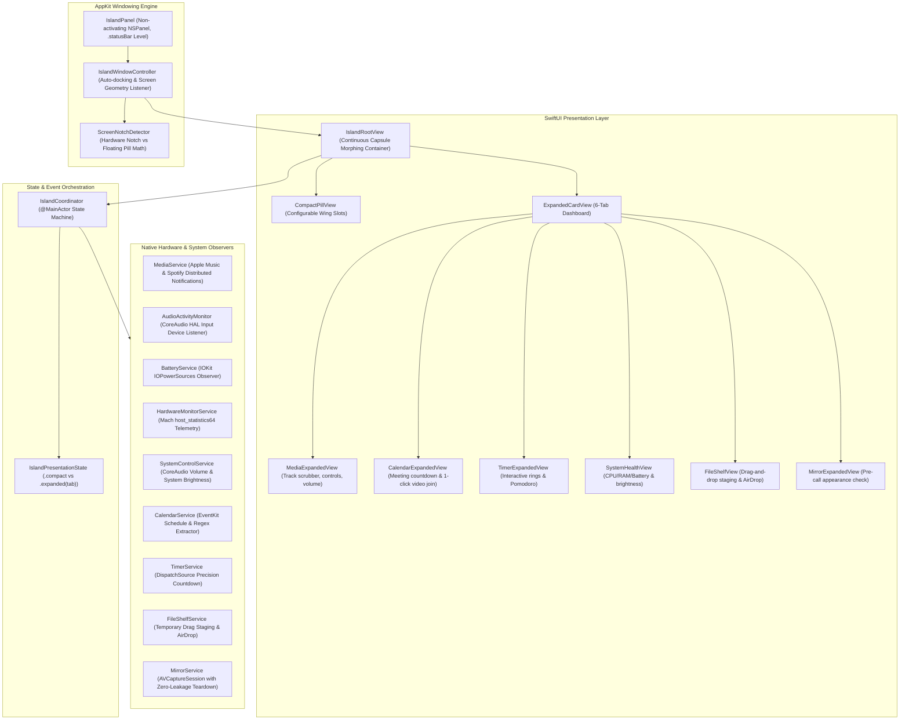

# OpenHalo Technical Architecture

OpenHalo is an open-source, zero-dependency native macOS status-item and Dynamic Island application built with **Swift 6**, **SwiftUI**, and **AppKit**.

---

## 1. High-Level System Architecture



---

## 2. Windowing Engine & Focus Invariants

### 2.1 Non-Activating Floating Panel
To maintain macOS system responsiveness without stealing keyboard focus or disrupting full-screen games, keynotes, or code editors:
- **Subclass**: `NSPanel` with styles `[.borderless, .nonactivatingPanel]`.
- **Window Level**: `.statusBar` (`CGWindowLevelKey.statusWindow`), placing the island cleanly over full-screen apps and system menu bars.
- **Collection Behavior**: `[.canJoinAllSpaces, .fullScreenAuxiliary, .ignoresCycle]`.
- **Keyboard Handling**: `canBecomeKey = false` ensures that typing in Xcode, Terminal, or Slack is never interrupted when hovering over or interacting with OpenHalo.

### 2.2 Notch Geometry Detection
```swift
// Hardware Notch Detection
let screen = NSScreen.main ?? NSScreen.screens[0]
let safeArea = screen.safeAreaInsets
let hasPhysicalNotch = safeArea.top > 0

if hasPhysicalNotch {
    // Docked flush against MacBook Pro / Air notch bezel:
    // Uses screen.auxiliaryTopLeftArea and auxiliaryTopRightArea to establish exact width
} else {
    // Floating Pill Mode:
    // Centered horizontally with an 8pt margin from screen.frame.maxY
}
```

---

## 3. Privacy & Security Implementation

### 3.1 Zero-TCC Microphone Activity Monitor
Unlike tools that record audio to visualize microphone activity, `AudioActivityMonitor` queries the CoreAudio Hardware Abstraction Layer directly:
- Listens for `kAudioDevicePropertyDeviceIsRunningSomewhere` on the default input device (`kAudioHardwarePropertyDefaultInputDevice`).
- Captures **zero audio samples and reads zero buffers**.
- Requires **no microphone recording permissions** (`NSMicrophoneUsageDescription`), ensuring user privacy by design.

### 3.2 Camera Power Cutoff Guard
To avoid leaving the MacBook hardware green camera LED illuminated:
- `MirrorService` only initializes the `AVCaptureSession` when `.mirror` is the actively viewed tab.
- As soon as the tab changes or the island collapses, `stopSession()` is invoked immediately on a high-priority background queue.
- Auto-collapse timers are temporarily paused while on the Mirror tab to avoid interrupting pre-call appearance checks.

---

## 4. Hardware Telemetry & Efficiency

- **Mach Kernel CPU & Memory**: `HardwareMonitorService` samples `host_processor_info` and `host_statistics64`. Polling is completely suspended whenever the island is collapsed, consuming virtually 0% CPU at idle.
- **Battery & AC Detection**: Powered by `IOKit/IOPowerSources` run-loop sources, receiving push notifications from macOS power management rather than busy-polling.
- **Zero Third-Party Dependencies**: OpenHalo imports only Apple system frameworks (`SwiftUI`, `AppKit`, `CoreAudio`, `IOKit`, `EventKit`, `AVFoundation`).
