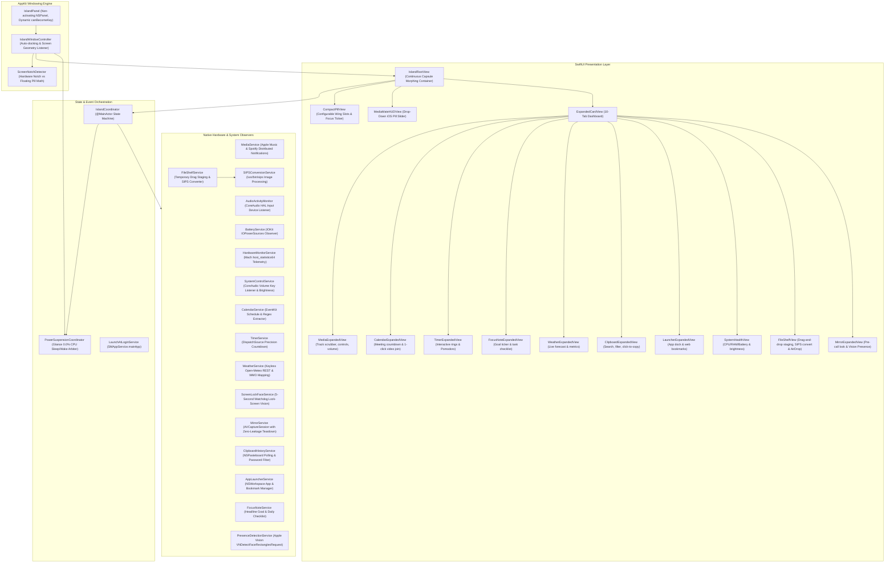

# OpenHalo Technical Architecture

OpenHalo is an open-source, zero-dependency native macOS status-item and Dynamic Island application built with **Swift 6**, **SwiftUI**, and **AppKit**.

---

## 1. High-Level System Architecture



---

## 2. Windowing Engine & Focus Invariants

### 2.1 Dynamic Non-Activating Floating Panel
To maintain macOS system responsiveness without stealing keyboard focus or disrupting active full-screen applications:
- **Subclass**: `NSPanel` with styles `[.borderless, .nonactivatingPanel]`.
- **Window Level**: `.statusBar` (`CGWindowLevelKey.statusWindow`), placing the island cleanly over full-screen apps and system menu bars.
- **Collection Behavior**: `[.canJoinAllSpaces, .fullScreenAuxiliary, .ignoresCycle]`.
- **Dynamic Keyboard Focus**: `canBecomeKey` is dynamically gated by `IslandCoordinator.shared.requiresKeyboardFocus`. During normal mouse moves, hover peeks, and tab navigation, focus is strictly rejected (`false`), ensuring Xcode, Terminal, or games are never interrupted. Focus is only temporarily acquired when clicking an active search or note input, and is immediately released on collapse.

### 2.2 Notch Geometry Detection
```swift
// Hardware Notch Detection
let screen = NSScreen.main ?? NSScreen.screens[0]
let safeArea = screen.safeAreaInsets
let hasPhysicalNotch = safeArea.top > 0

if hasPhysicalNotch {
    // Docked flush against MacBook Pro / Air notch bezel:
    // Uses screen.auxiliaryTopLeftArea and auxiliaryTopRightArea to establish exact width
} else {
    // Floating Pill Mode:
    // Centered horizontally with an 8pt margin from screen.frame.maxY
}
```

---

## 3. Privacy, Security & Power Optimization

### 3.1 Glance-Inspired Low-Power Engine (0.0% CPU)
OpenHalo registers deep sleep observers on `NSWorkspace.shared.notificationCenter`:
- `NSWorkspace.screensDidSleepNotification` & `willSleepNotification`
- `NSWorkspace.screensDidWakeNotification` & `didWakeNotification`

When sleep triggers, `PowerSuspensionCoordinator` stops all Mach kernel polling timers, halts CoreAudio listeners, pauses clipboard monitoring, and guarantees all camera capture sessions are terminated. On wake, it thaws listeners and resumes metrics in under 5 milliseconds.

### 3.2 5-Second Screen Lock Face ID Assistant
- **Strict 5.0-Second Watchdog Timer:** When the display locks and wakes, the camera starts in single-burst capture. If face recognition matches OR if 5.0 seconds elapse, the session is forcibly killed. The green camera LED is guaranteed to shut off within $\le 5.0$ seconds.
- **100% On-Device Neural Engine Processing:** Evaluated using `VNDetectFaceLandmarksRequest` and `VNDetectFaceCaptureQualityRequest`.
- **Zero Video or Image Storage:** Frames exist purely in volatile `CVPixelBuffer` memory. Only normalized landmark geometric ratios are stored locally for comparison.
- **Respect for macOS PAM & Touch ID Boundaries:** OpenHalo strictly avoids modifying `/etc/pam.d` or installing root daemons, preserving macOS System Integrity Protection (SIP) and Apple Silicon Secure Enclave security.

### 3.3 Zero-TCC Microphone Activity Monitor
Unlike tools that record audio to visualize microphone activity, `AudioActivityMonitor` queries the CoreAudio Hardware Abstraction Layer directly:
- Listens for `kAudioDevicePropertyDeviceIsRunningSomewhere` on the default input device (`kAudioHardwarePropertyDefaultInputDevice`).
- Captures **zero audio samples and reads zero buffers**.
- Requires **no microphone recording permissions** (`NSMicrophoneUsageDescription`).

### 3.4 Clipboard History Password Security Filter
`ClipboardHistoryService` filters out passwords by checking for concealed pasteboard types:
- Ignores `org.nspasteboard.ConcealedType`, `com.agilebits.onepassword`, and `org.nspasteboard.AutoGeneratedType`.
- Prevents master passwords copied from 1Password, Bitwarden, or Apple Keychain from ever entering clipboard history.

### 3.5 Built-In SIPS File Processing
Uses the native macOS `/usr/bin/sips` command line tool to convert staged files (PNG, JPEG, WebP, HEIC, TIFF) and resize them locally. Operates 100% offline with zero external dependencies.

### 3.6 Keyless Live Weather
Queries Open-Meteo REST API (`https://api.open-meteo.com/v1/forecast`) with 20-minute local TTL caching. Requires zero API keys or user tracking.
